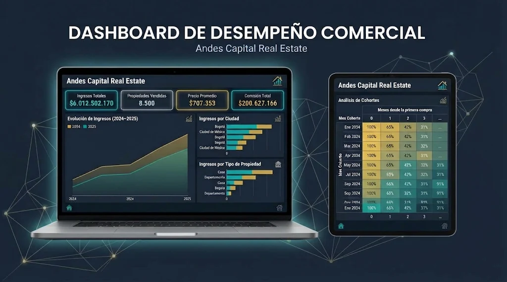

Dashboard interactivo de análisis comercial inmobiliario construido en **Power BI con modelo en **esquema estrella**, **tabla calendario (`dim_fecha`)**, métricas de **inteligencia de tiempo (YoY, YTD, MTD)** y **análisis de cohortes** para evaluar ventas, comisiones, propiedades y recurrencia de clientes.

## 📂 Contenido del repositorio
* `README.md` — Documentación del modelo de datos, vistas del *dashboard*, preguntas de negocio y conclusiones.

## 📊 Vistas y métricas clave
* **Análisis ejecutivo:** Ingreso total por ventas, comisiones generadas, volumen de transacciones y evolución temporal con acumulados *YTD / MTD* y crecimiento *YoY*.
* **Desempeño inmobiliario y comercial:** Rendimiento por tipo de propiedad, categoría, ciudad, barrio y canal de venta.
* **Clientes y cohortes:** Segmentos de compradores y recurrencia de compra tras la primera transacción.

## 💡 Preguntas claves abordadas
* ¿Cuál es el ingreso total y el monto de comisiones generado por las ventas de propiedades?
* ¿Qué tipo de propiedad, ubicación o canal impulsa más ingresos?
* ¿Qué segmentos de clientes compran más y cómo evolucionan las ventas año contra año?
* ¿Los clientes vuelven a comprar después de su primera compra?

* ## 📈 Métricas principales
* **Ingreso total:** $6.012.502.170
* **Cantidad de ventas:** 8.500 ventas
* **Ticket promedio:** $707.353
* **Comisión total:** $200.627.166

## 📌 Hallazgos clave
* El ingreso total del periodo alcanzó **$6.012.502.170** en **8.500 ventas**, con un ticket promedio de **$707.353** y una comisión total de **$200.627.166**.
* El tipo de propiedad con mayor ingreso es **Casa**, liderando la categoría con **$2.240.535.304** en **2.324 ventas**.
* **Ciudad de México** lidera en ingresos con **$3.242.231.285**, por encima de **Bogotá**, que registró **$2.770.270.885**.
* El canal de **Corredor** es el más relevante en ingresos (**$4.379.990.279**) y concentra el **72,72%** del total de ventas.

## 🔍 Insights accionables
* **Segmento principal:** Los compradores de **Primera vez** concentran el **62,93%** de las transacciones y **$3.783.579.998** en ingresos, mostrando un fuerte peso de la captación inicial frente a la recompra inmediata.
* **Dinámica geográfica:** Existe una brecha favorable a **Ciudad de México** frente a **Bogotá**, lo que abre espacio para trasladar prácticas comerciales exitosas entre plazas.
* **Peso del canal de corredores:** La intermediación de corredores impulsa la mayor parte de los ingresos y respalda el cierre de operaciones de alto valor como **Casa**.
* **Comportamiento por cohortes:** El mayor volumen e ingresos se concentran en el mes inicial (**Mes 0**) y caen en periodos siguientes, reflejando un patrón transaccional donde conviene impulsar la fidelización.

## 🎯 Recomendaciones estratégicas
* Priorizar inventario y pauta comercial en propiedades tipo **Casa** por su liderazgo en ingresos y demanda.
* Fortalecer el canal de **Corredores** con mejores herramientas y acompañamiento comercial dado su aporte en ingresos y volumen.
* Impulsar programas de retención y fidelización en cohortes recientes para fomentar la recompra y ampliar el ciclo de vida del cliente.
* Diseñar iniciativas de bienvenida y seguimiento para clientes de **Primera vez** con el fin de acelerar una segunda operación.
* Replicar en **Bogotá** las estrategias comerciales más efectivas de **Ciudad de México** para equilibrar el desempeño entre ciudades.

* Markdown
## 🔗 Acceso al dashboard en Power BI
* [Abrir archivo del proyecto (.pbix) en Google Drive](https://drive.google.com/file/d/17L7EZmSr88OTcpZqC5x3-rgmkV1waBqn/view?usp=sharing)
